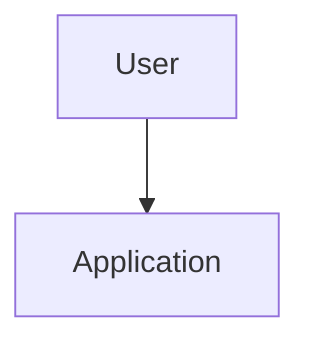
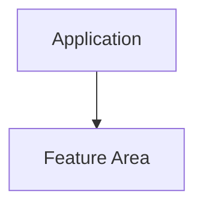
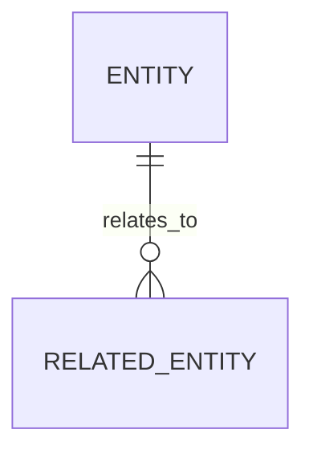
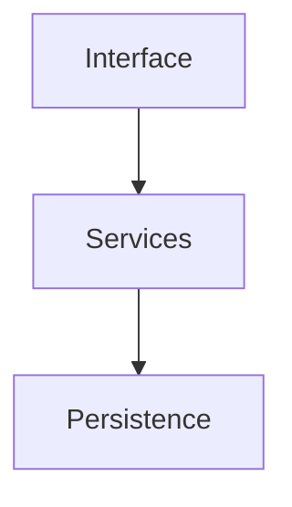
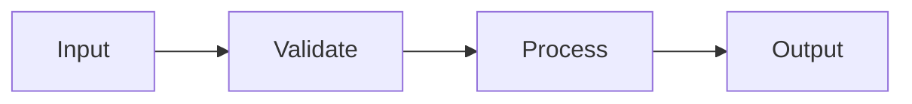

# Application Model

## Status
Draft / Active / Needs Review

## Application overview

## Users / actors

## Core workflows

## Feature areas

## Domain entities

## Data relationships

## System components

## Module boundaries

## Data flow

## State transitions

## External integrations

## Trust boundaries

## Failure modes

## Edge cases

## Test coverage strategy

## NOT in scope

## What already exists

## Risks / unknowns

## Decision briefs

## Last updated
- Date:
- Updated because:
- Confidence:
